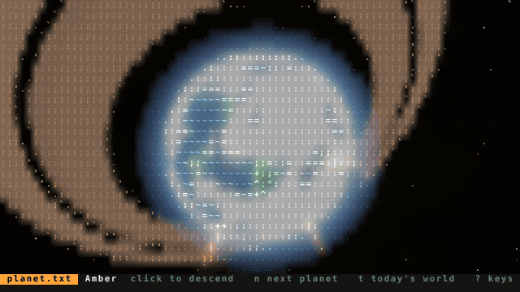
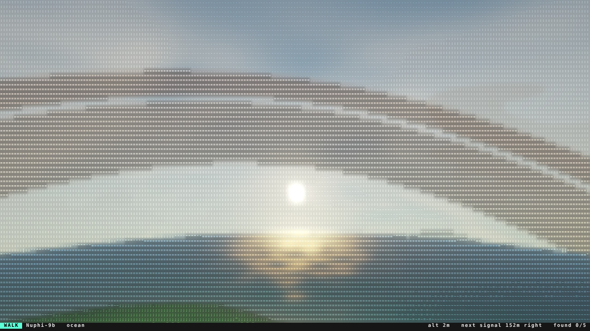
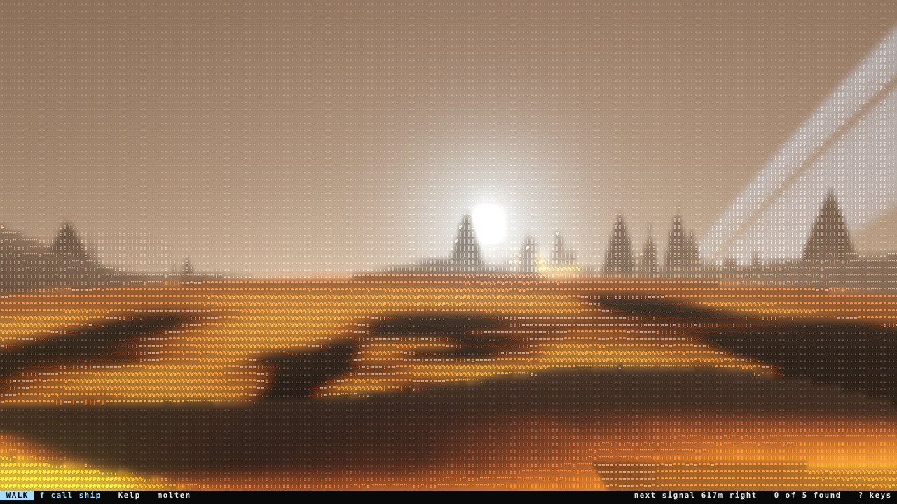
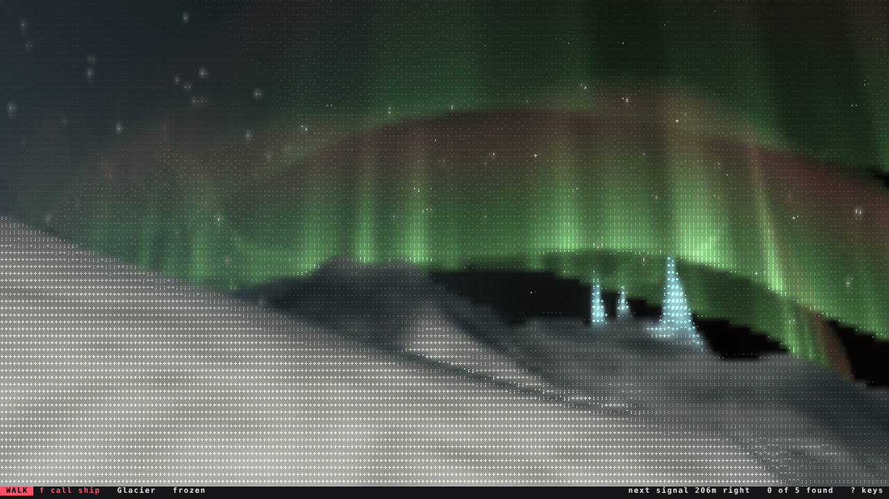
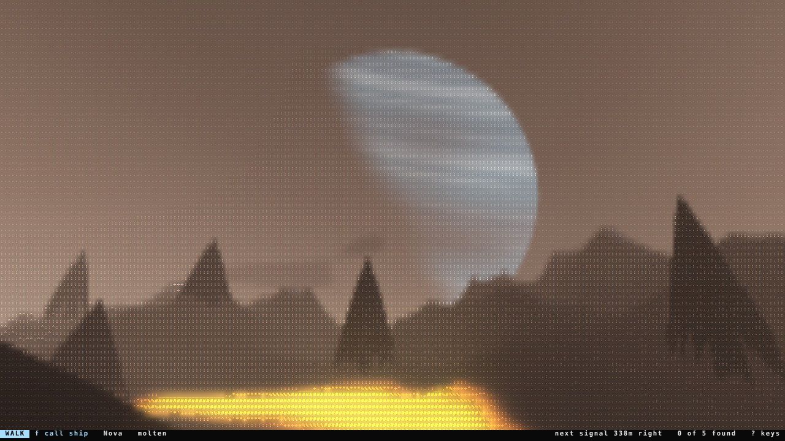

# planet.txt

A small planet you can fly down to and walk around on. Everything on screen is text.



One HTML file, no dependencies, no build step. Open `index.html` in a browser that has WebGL 2,
or play it at <https://wavy-hec.github.io/planet.txt/>.

## Playing

You start in orbit. Every planet has five signals on the ground, visible as beams of light in a
colour none of its ground has (a world that is almost all ocean may have fewer). Fly down to one, land, and walk into it:
a signal only counts on foot. Hold `W` and the ship dives, levels out and skims the land.
The status line at the bottom says how far the next signal is and which way to turn, and names
the key that does something where you are, such as `f land` once you are low enough. With the
sound on, the signals you have not read call out from a few hundred metres, louder as you come
closer and in the ear on their side; each one read rings its note and then holds it in the planet's
drone, so the chord fills out as you go and the fifth completes it.

Every planet also has one landform of its own kind: an atoll in the open sea, a lake in a ring of
hills, a canyon through the desert, a rift in the ice that glows from inside, a volcano with a lake
of lava, a grove of giant trees, or a great basin on an airless moon.

There is a little more to find. The first signals you read each mark a place on the chart (`tab`)
where something else stands, three at most: a ring of stones, the wreck of a lander, a cairn on the
planet's highest ground. They count for nothing; they are there to be walked up to. The rest is
looking around.


`?seed=amber`, sped up: down through the ring, a walk to the first signal, and back out to orbit.

| | |
|---|---|
| mouse | steer, look |
| `W` `A` `S` `D` | thrust and strafe, walk |
| `space` `C` | up and down, jump |
| `Q` `E` | roll |
| `shift` | boost, run |
| `F` | land and step out; on foot, board the ship or call it to you |
| `tab` | chart of the planet: you in the middle, the way you face at the top |
| `N` | next planet (press twice if you are partway through a survey) |
| `T` | today's world: one planet a day, the same for everyone |
| `J` | journal of the worlds where you have found something; a number goes back to one |
| `P` | save the view as a text file |
| `V` | show the render under the text |
| `-` `=` | bigger or smaller characters |
| `M` | sound |
| `?` | keys |

`W` `A` `S` `D` and the other movement keys go by position, so they work on any keyboard layout.
On a phone, the left half of the screen moves and the right half looks; there are buttons for up,
down, `F`, the chart, the journal, today's world, sound and a new planet.

The planet comes from the seed in the address bar, so `?seed=dust` is the same place for everyone.
The signals you have found are kept in your browser, so a planet you come back to is as you left it.

## Examples

| | |
|---|---|
|  |  |
| `?seed=amber`: sunset over the sea under a ring | `?seed=coral`: the lander parked among firs |
|  |  |
| `?seed=dust`: a desert at dawn | `?seed=glacier`: a crystal field on a frozen world |
|  |  |
| `?seed=kelp`: a lava sea at sunset | `?seed=amber` from orbit |
|  |  |
| `?seed=glacier` at night: an aurora | `?seed=nova`: a giant planet over a molten world |

Also worth a visit: `home` (a cratered moon with a ring) and `reef` (heather moors whose firs glow at night).
A seed that is a lowercase word of up to ten letters, alone or with a number of up to four digits
(`glacier`, `kelp-412`), names its world; any other gets a word from rock, weather or the sea and a
catalogue number, such as Haar 412.

On some worlds the moon's path crosses the sun's, and every half hour or so it passes in front of it.
Its shadow crosses the planet; where it is total the sky goes dark, the stars come out and the
horizon glows all the way round. `?seed=coral` and `?seed=dust` are two of them.

Every frozen world and some others have an aurora: curtains of green light round both magnetic poles,
red higher up, drawn in vertical strokes, that brighten and fade over a few minutes and show in the
sea. Meteors cross the night sky on every world with air, now and then a fireball that lights the
land; on some worlds they come in a shower from one point of the sky. Try `?seed=glacier` at night.
On the wetter worlds mist gathers in the low ground after dark and is thickest at dawn, so hills stand
out of it, until the sun burns it off. Snow comes in spells: anywhere on a frozen world, and on the
mountains and polar snow of the others. The ice in a frozen world's air rings the sun with a halo, and
with the sun low puts a bright spot on either side of it. One world in four has a giant planet in its
sky, banded, fixed among the stars: walk far enough over the curve and it sets.

`P` writes the frame out as plain text. This is `?seed=home` at 80 columns:

````
                                 .
            .
                 `

                                   .`
                                    .                                   .
                                  .`'...::....                  .`.`'':::''``.`
                               ....:::::::::,,:.`        ..::::*'''''':::;;;;;::
                             ..,..::::::,::::::,::` .`:':::::::;;;;;;:;;:`:;;;;:
                           ...:,.:,,,::,,,:^::::,:,:.`..        .:;;;;;:;;`.;;;;
                           .,:::.,.,:,:::::::::::::::.            :;;;;;;;; :;;;
 .                    .   .:::::::,:,:,,.:::::::,:,,,..           .;;;;:;;; :;;;
                         .::,:::::::::,,:::::,,::,,::,.          .;;;;;;;;'.;;;;
                         .,,::::,,:,::,,:::::,,:::::::,          :;;;;:;;:.:;;;;
                        ..:,:::::,::::,,,:::,::::::::,:.        ;;;;;;;;:.:;;;;:
                        ..::::::::::::::::,:,:::::::::.`      `;;;;;;;;: :;;;;;;
                        ..::,,::::::::,:::,,:,:::::::,:.    .;;;;;;;;;: :;;;;;;;
                         .::,,,:::::::,:,,,:::::::.,.:.   .:;;;;;:;;;``;;;;;;;;;
                       ::.,:,,,::::::::,,:::::::::,:::. .:;;;;;;;;;:.:;;;;;;;;:`
                     .::  ..:::,,,,,,,::,,:,:::,:::::.`:;;;;;:;;;:.`;;;;;;;;;:.
       .           .;:.   ..::::::,,,,,::,,,:::,:,:::;;;;;;:;;;:.`:;;;;:;;;:'
                 `;;:      .,.:,,,:::,,:::::::::,:;;;;;;;;;;;:.`:;;;;;;:;;'`
                :;;.       `...::::....::::::::^;;;;;;;:;;;:.`:;;;;;;;;;:`
              .::;`            ...::,:,,:::::;;;;;;;;;;;;` `;;;;;;;;;;:`
            .;';;;               .....:::;;;:;;;::;;;;:..:;;;;;;;;;;:`.
           `;';;;;                  `::;;;;;;;;::;;:```:;;;;;;;;;;:`
          .;`;;;;;:`         ..`';;;;;;;;;::;:;;:`.`:;;;;;;;;;;;:`.
         :;;.;;;;;;;;::::::;;;;;;;;;;;;:;:;;;:`.`:;;;;;;;;;;;;'.            .
        `;;':;:;;;;;;;;;;;;;;;;;:;:;;;;;;:.```:;;;;;;;:;;;;:`
       .;;;'.;;:;:;;;;;;;:;::::;;;;;;::``':;;;;;;;;;;;;;:'`
       :;;;:..;;;;;;;:;;:;;;;;;;::````:;;;;;;;;;;;;;;:'..
````

## How it works

A planet is 480 to 660 m in radius, three to four kilometres round. It is a height map on the six
faces of a cube, 1024x1024 each, a point every metre or so, built from the seed with layered
Perlin noise: one layer for continents, a ridged one for mountains, a fine one for roughness. Some
kinds of planet add craters or terraces. Trees, crystals and rock spires are stamped in as bumps.
Normals, colours and a material for every texel are baked in the same pass. All of that runs once
on the CPU and takes two or three seconds; the heights are worked out on worker threads where the
browser has them. The same heights are what the ship and your feet collide with.

Drawing is three passes on the GPU.

1. Ray march the height map into a small buffer, a 2x3 block of pixels for every character cell
   (4x6 while the machine keeps up). Sunlight, shadows, sea, clouds, rings and the atmosphere are
   all in this one shader.
2. One pixel per cell: choose the character. A flat cell takes one from its material's own set
   by brightness, so water is `-~=`, rock is `^+#`, trees are `+*%&#`. Where a cell has an edge
   in it, a line character (`_ / \ ( ) ' "`) can stand in, but only if its shape fits: every
   glyph is measured once for how much ink falls in each of six regions of its cell, and that is
   compared with the cell's six samples. There are no letters or digits in the picture.
3. Stamp the glyphs from an atlas at full resolution over a background colour that is blended
   between cells, add bloom, and write the status line on top.

Three things keep the picture steady.

- A tree or a rock spire is a near-vertical wall, so the height of a ray above the ground says
  little about how far it can safely go. The march reads a small pyramid of maps of the highest
  and steepest ground in each block: long steps where the way is clear, short ones among steep
  things, so a spire or a tree near you is not stepped over whole.
- Surface detail (the mottling of the ground, the tiers of a fir, the strata of a rock) is drawn
  only where the picture can resolve it. Anything finer than about four characters fades out,
  because the picture would show it only as static.
- Land is drawn with dots, commas and crosses. The characters that run together into long lines
  across the screen (`-`, `~`, `=`) are kept off the land; water and lava get them. Far ground
  gets lighter characters than near ground, and one character gives way to the next through a
  stipple of the two.

The height map is too coarse for anything small. So the parked lander, the things to find and the
dozen trees nearest you are drawn as real shapes, signed distance functions marched in the same shader. Each tree
grows out of the terrain's plain cone as you walk up to it.

Matching glyphs by shape rather than brightness comes from Alex Harri's article
[ASCII characters are not pixels](https://alexharri.com/blog/ascii-rendering).

## License

MIT
