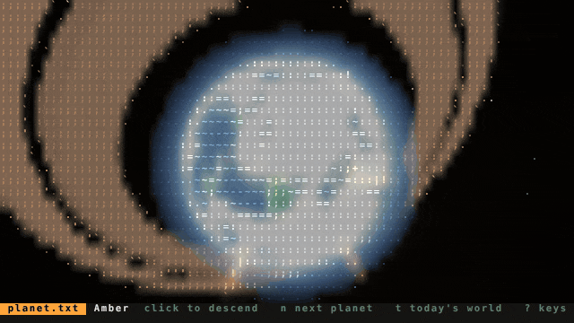
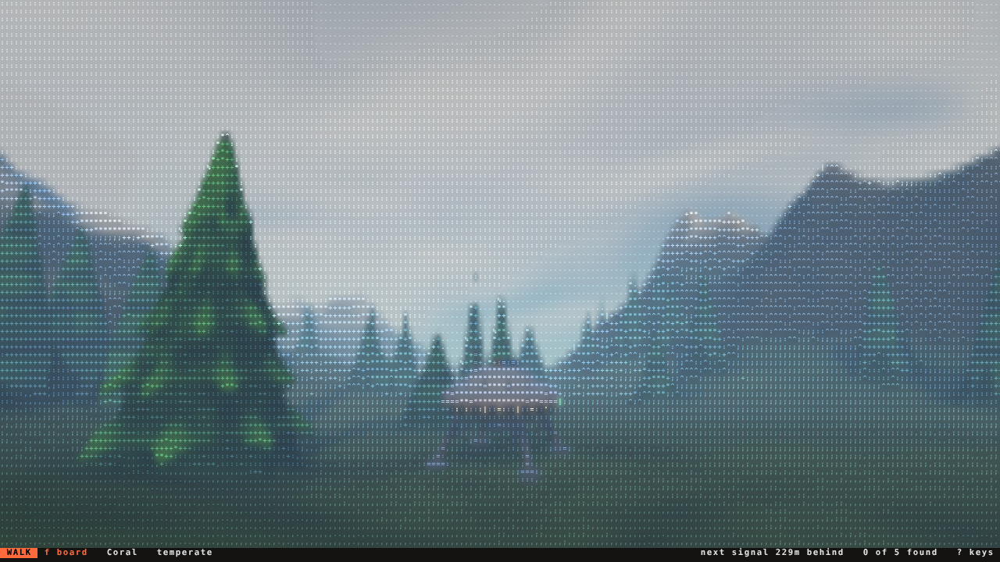
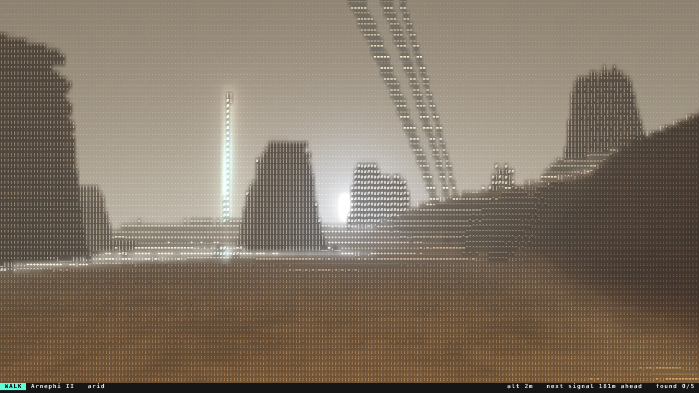
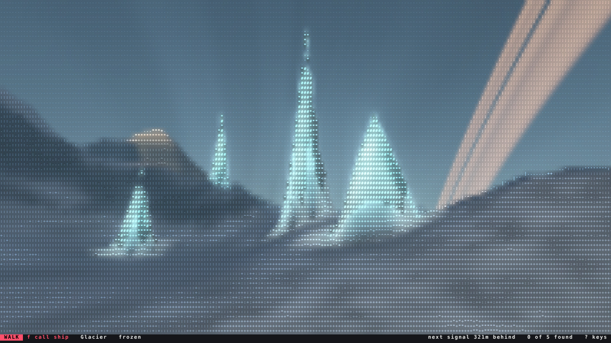
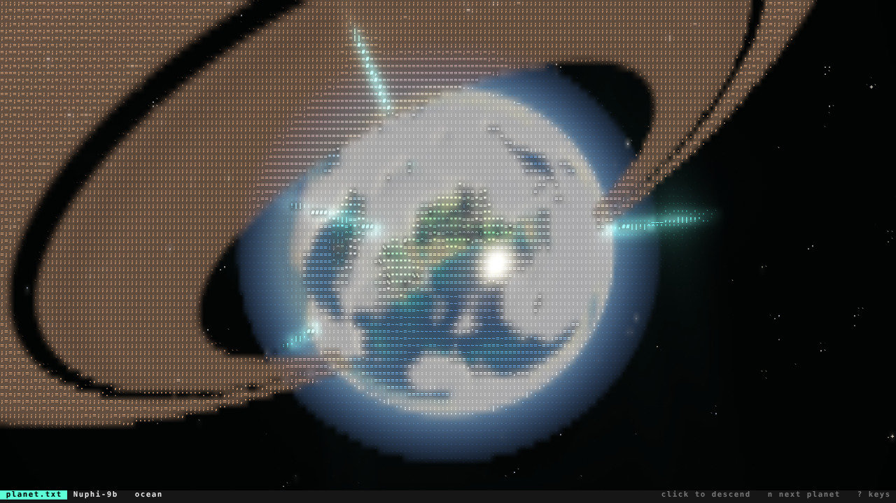

# planet.txt

A small planet you can fly down to and walk around on. Everything on screen is text.


One HTML file, no dependencies, no build step. Open `index.html` in a browser that has WebGL 2,
or play it at <https://wavy-hec.github.io/planet.txt/>.

## Playing

You start in orbit. Every planet has five signals on the ground, visible as beams of light
(a world that is almost all ocean may have fewer). Fly down to one, land, and walk into it.
The status line at the bottom says how far the next one is and which way to turn. That is
the whole game; the rest is looking around.



`?seed=amber`, sped up: down through the ring, a walk to the first signal, and back out to orbit.

| | |
|---|---|
| mouse | steer, look |
| `W` `A` `S` `D` | thrust and strafe, walk |
| `space` `C` | up and down, jump |
| `Q` `E` | roll |
| `shift` | boost, run |
| `F` | land and step out, board and lift off |
| `N` | next planet (press twice if you are partway through a survey) |
| `P` | save the view as a text file |
| `V` | show the render under the text |
| `-` `=` | bigger or smaller characters |
| `M` | sound |
| `?` | keys |

`W` `A` `S` `D` and the other movement keys go by position, so they work on any keyboard layout.
On a phone, the left half of the screen moves and the right half looks; there are buttons for up,
down, `F`, sound and a new planet.

The planet comes from the seed in the address bar, so `?seed=dust` is the same place for everyone.

## Examples

| | |
|---|---|
|  |  |
| `?seed=amber`: sunset over the sea under a ring | `?seed=coral`: the lander parked among firs |
|  |  |
| `?seed=dust`: a desert at dawn | `?seed=glacier`: a crystal field on a frozen world |
|  |  |
| `?seed=kelp`: a lava sea at sunset | `?seed=amber` from orbit |

Also worth a visit: `home` (a cratered moon with a ring) and `reef` (pink and violet, with glowing trees).

`P` writes the frame out as plain text. This is `?seed=home` at 80 columns:

````
   .   .    .        .        .      . .    . .        .        .        .
.      . .        .      . .      .        .        .      . .        .        .
      .      .        .        .        .        .      . .    .   .        .
 .        .    .   .        .      . .      . .        .        .           . .
       .        .    .   .      . .      . .      . .      .    ..``'',::;;;;;;;
    .        .        .      . .      ....     .        ...``,:;;;;;;;;;;;=;;;;;
 .        .    . . .... . .      `,:::=^====,`     ..',:;;;;;;;;::,,,''''':;=;,.
 .            .      '''. . . ..:::======+======,:;;;;;;::,''',::;;;;;;;;`::'.
  .        .        .  '+*```:^;^^====++++=========::'',:;;;;;;;;==;;;;:.'   .
    .  ..        .    ..`^\_;;::^^==================;;;::|'''. . ';;:,'       .
     .        .      . .. .='::^=========++=========^'   .     .,:..       .
. .        .      .    . .^==========================;'    ....`        ..
  . . `        .    ..':;======;=========^+++=====+++^; ..``.        .        .
   .        .    `':;;;;;==^==============++=++====+==;` .      .        .
.        .  ..':;;;;::'::====;===++++===++===+==+==;===;     .        .        .
      .  .`:;;;;:,',:;;;;;^^;;;=;==;==^=+++==+===^;::===. .        .        .
   .  `,;;;;;:',:;;;;,' .::;;:;=;^^===^=++===++===;^^+==      . .        .
   `:;;;;|,',;;;;:'. . ..::=;:^==:::^=::^++++=+++=;====:   . .      . .  .   .
`:;;;;:,',;;;=:'    ..`'_:,=^;:==^^;^:;::===+++====;===.. .      .        .
;;;;:`:;;;;==`   ..``:|^'.::=^:^==^=^;::^^======;;;===`     . .        .
;=;: :=;;;:;;:,''' . . .. .,^=^^===;;;::=========;;==' . . .        .     .  .
;;;::....'`.        .    . .:^^:===;;:^;============*+'`.        .        .
      . .        .      . . .;;::^;==;;;===========`.'*|'.. . .      . .      .
     .        .      . .      ',;;;:^=========^=^'   ..`'|,       .    .   .
  .        .      . .      . .  .'::^:^^^====::`  . . .  ...   .        .
        .      .        .        .    .'`...     . .        .        .        .
   .        .        .    .   .        .      . .      . .        .
.        .        .  .     .      . .      . .    . . .      .        .        .
      .        .      . .      . .      . .      .        .        .        .
   .        .        .      .  .     .        .        .        .        .
     .          .        .        .      . .        .        .        .        .
````

## How it works

The planet is a height map on the six faces of a cube, 512x512 each, built from the seed with
layered Perlin noise: one layer for continents, a ridged one for mountains, a fine one for
roughness. Some kinds of planet add craters or terraces. Trees, crystals and rock spires are
stamped in as bumps. Normals, colours and a material for every texel are baked in the same pass.
All of that runs once on the CPU, in about a second, and the same heights are what the ship and
your feet collide with.

Drawing is three passes on the GPU.

1. Ray march the height map into a small buffer, a 2x3 block of pixels for every character cell
   (4x6 while the machine keeps up). Sunlight, shadows, sea, clouds, rings and the atmosphere are
   all in this one shader.
2. One pixel per cell: choose the character. A flat cell takes one from its material's own set
   by brightness, so water is `-~=`, rock is `^=`, trees are `+*%&#`. Where a cell has an edge
   in it, a line character (`_ / \ ( ) ' "`) can stand in, but only if its shape fits: every
   glyph is measured once for how much ink falls in each of six regions of its cell, and that is
   compared with the cell's six samples. There are no letters or digits in the picture.
3. Stamp the glyphs from an atlas at full resolution over a background colour that is blended
   between cells, add bloom, and write the status line into the same grid.

The height map holds about one point per metre, too coarse for anything small. So the parked
lander and the dozen trees nearest you are drawn as real shapes, signed distance functions marched
in the same shader. Each tree blends back into the terrain's plain cone as you walk away from it.

Matching glyphs by shape rather than brightness comes from Alex Harri's article
[ASCII characters are not pixels](https://alexharri.com/blog/ascii-rendering).

## License

MIT
